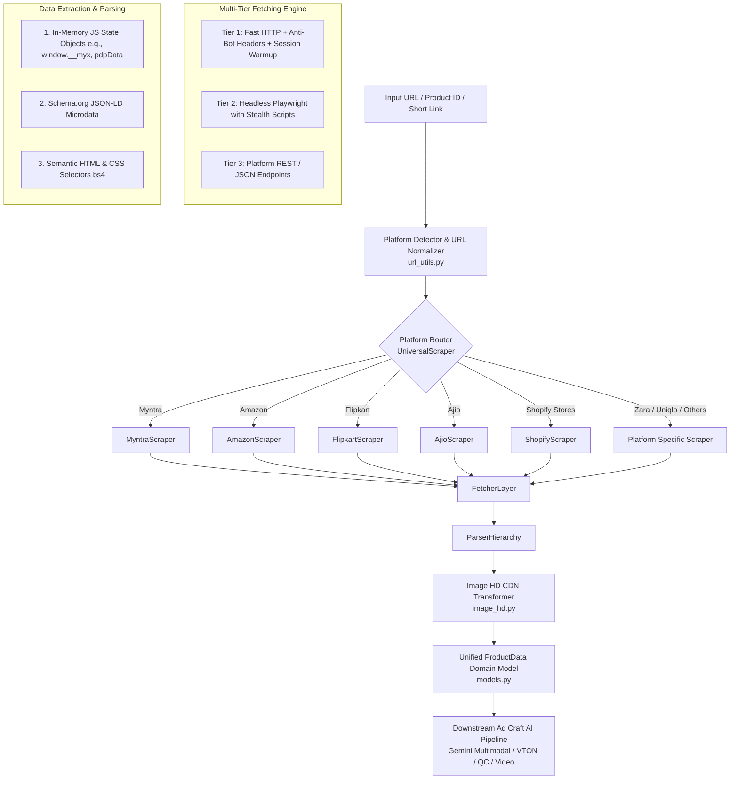

# Multi-Platform E-Commerce Product Scraper Engine

A production-grade, multi-platform product scraping and extraction engine designed for modern e-commerce websites. It powers the ingestion layer of the **Ad Craft AI Pipeline**, fetching high-resolution product assets, structured metadata, pricing, specifications, and customer sentiment across 11+ major platforms.

---

## Table of Contents
1. [Overview & Architecture](#overview--architecture)
2. [Supported Platforms Matrix](#supported-platforms-matrix)
3. [Technology Stack](#technology-stack)
4. [Multi-Tiered Fetching & Reader Engine](#multi-tiered-fetching--reader-engine)
5. [Data Extraction & Key Selection Strategy](#data-extraction--key-selection-strategy)
   - [Level 1: Hydrated / Preloaded JavaScript State](#level-1-hydrated--preloaded-javascript-state)
   - [Level 2: Semantic Microdata & Schema.org JSON-LD](#level-2-semantic-microdata--schemaorg-json-ld)
   - [Level 3: Semantic HTML & CSS Selectors](#level-3-semantic-html--css-selectors)
6. [Image Discovery & High-Resolution (HD) CDN Optimization](#image-discovery--high-resolution-hd-cdn-optimization)
7. [Connection with AI Models & Gemini Calls](#connection-with-ai-models--gemini-calls)
8. [Unified Domain Model (`ProductData`)](#unified-domain-model-productdata)
9. [Module Structure](#module-structure)
10. [Usage Examples](#usage-examples)

---

## Overview & Architecture

Modern e-commerce platforms employ complex client-side rendering (React, Vue, Next.js), aggressive anti-bot protection (Akamai Bot Manager, Cloudflare, PerimeterX), and dynamic CDN image resizing. 

This engine is engineered to solve these challenges deterministically without relying on fragile single-selector scrapers. It follows a multi-tier fallback architecture:



---

## Supported Platforms Matrix

| Platform | Extraction Strategy | Primary Data Source | High-Res CDN Support |
| :--- | :--- | :--- | :--- |
| **Myntra** | In-memory JS State + OpenGraph | `window.__myx['pdpData']` | `w_1080,q_95` param rewrite |
| **Amazon** | `colorImages` JSON + JSON-LD + CSS | Inlined `colorImages` JS + Schema.org | Strips dynamic dimension tags (`._UX..._.jpg`) |
| **Flipkart** | Embedded State + JSON-LD | `__INITIAL_STATE__` / Schema.org | `/image/1080/1080/` upscaling |
| **Ajio** | Hydrated Redux / React State | `window.__PRELOADED_STATE__` | Dynamic width substitution |
| **Nykaa / Nykaa Fashion** | Preloaded State + JSON-LD | `__NEXT_DATA__` / API State | `tr:w-1080,q-95` Cloudinary CDN transform |
| **The Souled Store** | Inlined JSON State + Microdata | Window state scripts | High-res asset path mapping |
| **Bewakoof** | JSON State / Direct API | Embedded product state | Transforms `/compressed/` / `/t320/` to `/original/` |
| **Pantaloons** | Microdata + DOM | JSON-LD / HTML Meta | Dynamic `w=1080` param substitution |
| **Zara** | Inlined App State / Catalog API | Script state objects | Replaces `{width}` / `/w/2048/` |
| **Uniqlo** | Product Catalog API / JSON | Uniqlo API / Next.js payload | High-res product shot links |
| **Shopify Stores** *(Snitch, BlissClub, XYXX, Mokobara, etc.)* | Native JSON Endpoint + DOM Probe | `/products/<handle>.json` | Removes `_small`, `_medium`, `_1024x1024` suffixes |

---

## Technology Stack

- **Python 3 Standard Library**:
  - `urllib.request`: Lightweight, high-throughput HTTP engine with custom SSL contexts.
  - `re`: High-performance regular expressions for JSON isolation and URL extraction.
  - `json`: `json.JSONDecoder().raw_decode` for streaming JS object parsing without regex breakage.
  - `gzip`, `zlib`: Stream decompression for compressed web responses.
- **Parsing & Extraction**:
  - `BeautifulSoup4` (`bs4`): Robust HTML DOM traversal, tag navigation, and fallback extraction.
- **Browser Automation & Anti-Bot Bypass**:
  - `Playwright` (`playwright.sync_api`): Headless Chromium, Google Chrome, and Microsoft Edge runner for dynamic JS hydration.
  - Custom Stealth Scripts: Neutralizes `navigator.webdriver`, masks automation flags, simulates realistic viewport and language headers.
- **Compression & Network**:
  - `brotli`: Brotli decompression (`Accept-Encoding: br`) to match modern browser traffic profiles.
  - `requests.Session`: Cookie preservation and session warmup for Akamai Bot Manager bypass.
- **Schema & Typing**:
  - `Pydantic` (`BaseModel`, `Field`): Domain model validation, type-safe serialization, and pipeline integration.

---

## Multi-Tiered Fetching & Reader Engine

Anti-scraping systems flag bots based on missing session cookies, mismatched TCP/OS fingerprints, and missing JavaScript execution. The scraper implements a 3-tier hybrid fetcher:

### 1. Tier 1: Fast HTTP Fetcher (Zero Browser Overhead)
- **OS-Matched User-Agents**: Automatically detects host OS (Linux vs macOS vs Windows) to align User-Agent strings with the host's actual TCP/IP stack fingerprint (preventing Akamai OS-mismatch flags on Linux servers).
- **Session Cookie Warmup (`_get_warm_session`)**: Pre-warms an active session by requesting the platform homepage to acquire valid session tokens and edge cookies.
- **Header Preservation Redirect Handler (`PreserveHeadersRedirectHandler`)**: Prevents standard Python `urllib` from dropping critical anti-bot headers during HTTP 301/302 redirects.
- **Client-Side JS Redirect Detection**: Detects JavaScript redirects (`location.href = "..."` or `location.replace(...)`) in minimal HTML response payloads and automatically follows them.

### 2. Tier 2: Playwright Headless Browser Fallback
Triggered when HTTP fetch encounters anti-bot challenges (such as Akamai Access Denied, Captcha, or blank pages without hydration state):
- **Stealth Initialization**: Injects stealth JavaScript into every browser page:
  ```javascript
  Object.defineProperty(navigator, 'webdriver', { get: () => undefined });
  Object.defineProperty(navigator, 'languages', { get: () => ['en-US', 'en'] });
  Object.defineProperty(navigator, 'plugins', { get: () => [1, 2, 3, 4, 5] });
  window.chrome = { runtime: {} };
  ```
- **Multi-Channel Fallback**: Sequentially tries Google Chrome (`channel="chrome"`), Microsoft Edge (`channel="msedge"`), and bundled Chromium.
- **Hydration Wait Loop**: Actively polls for window hydration markers (e.g., `window.__myx`, `pdpData`, `__INITIAL_STATE__`) for up to 6 seconds before DOM snapshotting.

### 3. Tier 3: Direct JSON API Endpoints
- For platforms like **Shopify**, automatically detects and probes the native endpoint:
  ```http
  GET /products/{product-handle}.js
  GET /products/{product-handle}.json
  ```
  Returns pure JSON data instantly without executing browser JavaScript.

---

## Data Extraction & Key Selection Strategy

To guarantee data accuracy, extraction occurs through a strict priority hierarchy:

```
[In-Memory JS State] ──(fallback)──> [Schema.org JSON-LD] ──(fallback)──> [HTML & CSS Selectors]
```

### Level 1: Hydrated / Preloaded JavaScript State
Modern frontend frameworks store complete product dictionaries in `<script>` tags on initial page load:
- **Myntra**: Isolates `window.__myx = { pdpData: ... }` using `json.JSONDecoder().raw_decode()`. Extracts exact product dimensions, color swatches, stock availability per SKU, seller details, return periods, and ratings.
- **Amazon**: Extracts dynamic JSON structures:
  - `'colorImages': {'initial': [...]}` -> Full gallery of hi-res zoom images.
  - `data-a-dynamic-image` -> Multiple resolution maps per variant.
- **Flipkart / Ajio / Nykaa**: Extracts `window.__INITIAL_STATE__` or `__PRELOADED_STATE__` JSON payloads containing category breadcrumbs, specification tables, and discount calculations.

### Level 2: Semantic Microdata & Schema.org JSON-LD
Extracts structured metadata from `<script type="application/ld+json">`:
- `name`: Product title.
- `brand.name`: Brand or designer.
- `offers.price` & `offers.priceCurrency`: Standardized pricing and currency code (`INR`, `USD`, `EUR`, `GBP`, etc.).
- `offers.availability`: Stock status (`InStock`, `OutOfStock`).
- `aggregateRating.ratingValue` & `reviewCount`: Customer ratings.

### Level 3: Semantic HTML & CSS Selectors
When script objects are obscured or dynamically loaded, BeautifulSoup CSS selectors extract target fields:
- **Product Title**: `#productTitle`, `h1.pdp-title`, `.product-title`, `meta[property="og:title"]`.
- **Pricing & Discounts**: `.a-price .a-offscreen`, `span.pdp-price`, `span.pdp-mrp`, regex cleaning currency symbols (`₹`, `$`, `£`, `,`).
- **Brand Information**: `#bylineInfo`, `.pdp-title`, `meta[property="og:brand"]`.
- **Product Specifications**: Traverses product feature tables, bullet lists (`#feature-bullets`), and detail definition lists (`dt`/`dd` pairs).

---

## Image Discovery & High-Resolution (HD) CDN Optimization

The AI video pipeline requires high-resolution imagery. E-commerce platforms typically serve low-resolution or compressed thumbnails by default. The scraper's `image_hd.py` module applies deterministic regex transformations across various CDNs:

| Platform CDN | Raw Scraped URL Pattern | Transformed High-Definition (HD) URL |
| :--- | :--- | :--- |
| **Myntra** | `.../assets/images/.../h_($height),q_($quality),w_($width)/...jpg` | Rewritten to `w_1080,q_95` |
| **Amazon** | `https://m.media-amazon.com/images/I/71xyz._AC_UL320_.jpg` | Strips `._AC_UL320_` -> `https://m.media-amazon.com/images/I/71xyz.jpg` |
| **Flipkart** | `https://rukminim2.flixcart.com/image/128/128/xyz.jpeg` | Transforms to `/image/1080/1080/xyz.jpeg` |
| **Shopify** | `https://cdn.shopify.com/s/files/.../shirt_medium.jpg` | Strips suffix and adds `?width=1080` |
| **Nykaa** | `https://adn-static1.nykaa.com/.../tr:w-300,pr-true/...jpg` | Rewritten to `tr:w-1080,q-95/...jpg` |
| **Zara** | `https://static.zara.net/photos/.../w/563/...jpg` | Transformed to `/w/2048/...jpg` |
| **Bewakoof**| `https://images.bewakoof.com/t320/product.jpg` | Transformed to `https://images.bewakoof.com/original/product.jpg` |

### Image Hygiene & Filtering
- Automatically discards dummy/tracking pixels (`grey-pixel`, `sprite`, `play-button`, `transparent-pixel`, `overlay`).
- Deduplicates identical images across multiple resolutions.
- Extracts multiple view angles (Front, Back, Side, Macro Detail, Model Lookbook).

---

## Connection with AI Models & Gemini Calls

The scraper operates deterministically and provides structured data to the downstream AI pipeline:

```
[Web Scraper Engine]
         │
         ▼ (Structured ProductData + Downloaded HD Images)
[Scraper Ingestion Service (src/services/scraper_ingestion.py)]
         │
         ▼
[Ad Craft AI Generation Pipeline]
         ├─► 1. Gemini Multimodal Garment & Style Analysis (google-genai)
         │      • Inspects scraped HD images + title + description
         │      • Analyzes garment type, fabric silhouette, occasion
         │      • Selects 4-5 thematic ad scenes (e.g., 'festive hall', 'wedding venue')
         │
         ├─► 2. Contextual Prompt Generation
         │      • Crafts model persona, pose, camera angle, and scene lighting
         │
         ├─► 3. AI VTON & Image Generation Models
         │      • Generates photorealistic models wearing the scraped garment
         │
         ├─► 4. Gemini Multi-Stage QC Gatekeeper
         │      • Vision audit comparing generated images against original scraped garment
         │      • Checks seam fidelity, print accuracy, anatomy, and photo realism
         │
         └─► 5. Gemini Script Generation & Video TTS
                • Crafts video ad copy using scraped pricing, discount, and selling points
```

---

## Unified Domain Model (`ProductData`)

All scrapers return a standardized `ProductData` object (`models.py`):

```python
class ProductData(BaseModel):
    platform: str                          # e.g., 'myntra', 'amazon', 'shopify'
    style_id: Union[int, str]              # Unique platform product identifier
    canonical_url: str                     # Clean canonical URL
    product_url: str                       # Source input URL
    title: str                             # Product title
    subtitle: Optional[str]                # Product subtitle / short description
    brand: BrandInfo                       # Brand name, UID, logo
    price: PriceInfo                       # MRP, selling price, discount %, currency
    media: List[ImageMedia]                # Raw and HD image objects with view types
    hd_image_urls: List[str]               # Ordered list of high-resolution image URLs
    sizes: List[SizeOption]                # Available sizes and inventory status
    in_stock: bool                         # Overall stock availability
    color_variants: List[ColorVariant]     # Alternative color style IDs and thumbs
    specifications: List[Specification]    # Key-value attribute list
    product_description_sections: List[Dict[str, str]] # Formatted description sections
    breadcrumbs: List[str]                 # Category navigation tree
    category: str                          # Article category (e.g., 'Lehenga Choli')
    gender: str                            # Target gender / demographic
    ratings: RatingSummary                 # Average rating, review counts, star breakdown
    reviews: List[Review]                  # Top customer reviews with user photos
    seller: SellerInfo                     # Seller partner, rating, return window
    flags: ServiceFlags                    # COD enabled, returnable, try-and-buy
    scraped_at: str                        # UTC timestamp of scrape event
```

---

## Module Structure

```
ad-craft-pipeline/src/scrapper/
├── __init__.py                # Package exports and public entrypoints
├── models.py                  # Pydantic schemas (ProductData, PriceInfo, etc.)
├── url_utils.py               # Platform detection & URL normalization regex
├── fetcher.py                 # Multi-tier HTTP & Playwright fetcher with anti-bot bypass
├── parser.py                  # Top-level UniversalScraper & MyntraScraper
├── image_hd.py                # Multi-platform high-definition CDN transformer & downloader
├── loop_policy.py             # Event loop policy manager for Playwright async/sync safety
├── amazon_scraper.py          # Amazon ASIN parser & gallery extractor
├── flipkart_scraper.py        # Flipkart PID parser & state extractor
├── ajio_scraper.py            # Ajio product code parser & state extractor
├── nykaa_scraper.py           # Nykaa Beauty scraper
├── nykaafashion_scraper.py    # Nykaa Fashion scraper
├── bewakoof_scraper.py        # Bewakoof catalog scraper
├── souledstore_scraper.py     # The Souled Store scraper
├── pantaloons_scraper.py      # Pantaloons scraper
├── zara_scraper.py            # Zara catalog scraper
├── uniqlo_scraper.py          # Uniqlo product & API scraper
└── shopify_scraper.py         # Universal Shopify store probe and JSON parser
```

---

## Usage Examples

### 1. Universal Scraping (Any Platform URL)
```python
from scrapper import scrape_product

# Automatically detects platform (Myntra, Amazon, Flipkart, Shopify, etc.)
product = scrape_product("https://www.myntra.com/lehenga-choli/kalini/42691464/buy")

print(f"Title: {product.title}")
print(f"Brand: {product.brand.name}")
print(f"Price: {product.price.currency} {product.price.selling_price} (MRP: {product.price.mrp})")
print(f"HD Images Found ({len(product.hd_image_urls)}):")
for url in product.hd_image_urls:
    print(f" - {url}")
```

### 2. Platform-Specific Extraction
```python
from scrapper.amazon_scraper import AmazonScraper
from scrapper.shopify_scraper import ShopifyScraper

# Direct Amazon ASIN scrape
amz_product = AmazonScraper.scrape_url("B09X7GXYZ1")

# Direct Shopify store scrape
shopify_product = ShopifyScraper.scrape_url("https://snitch.co.in/products/classic-linen-shirt")
```

### 3. Pipeline Ingestion Integration
```python
from services.scraper_ingestion import ScraperIngestionService
from core.models import PipelineContext

context = PipelineContext(run_id="demo_001")
ingestion = ScraperIngestionService()

product_data = ingestion.ingest(
    context=context,
    product_url="https://www.myntra.com/lehenga-choli/kalini/42691464/buy"
)

# Downloaded HD images are stored in context.input_dir for AI processing
print(f"Downloaded local images: {product_data.image_paths}")
```
