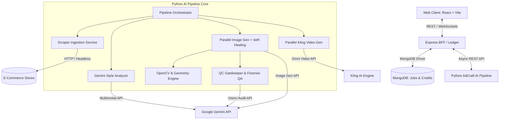
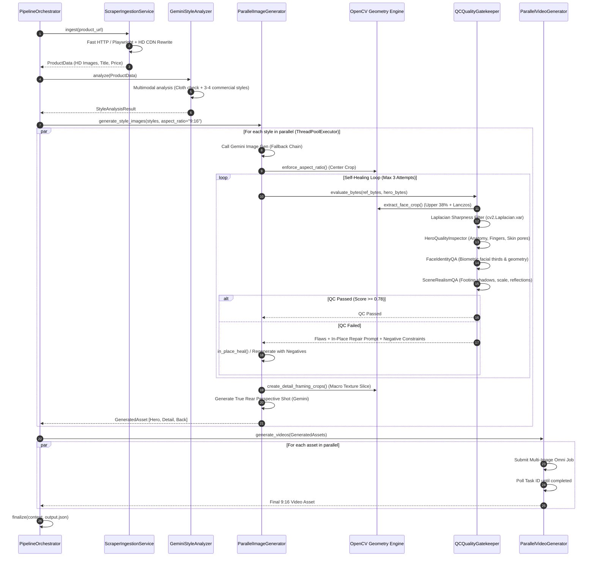

# AdCraft AI Video Pipeline — Comprehensive High-Level & Low-Level Design (HLD & LLD)

> **Document Version:** 2.0  
> **Target Audience:** AI Engineers, Backend Architects, Computer Vision Specialists, and System Maintainers.  
> **Focus:** Full Architecture, Computer Vision, Multi-Stage Generative AI, Biometric Face QA, Scene Realism QA, OpenCV Processing, and Self-Healing Quality Gatekeeper.

---

## Table of Contents
1. [Executive Summary](#1-executive-summary)
2. [High-Level Design (HLD)](#2-high-level-design-hld)
   - 2.1 System Architecture & Microservices Topology
   - 2.2 End-to-End Workflow & Dataflow Diagram
   - 2.3 Technology Stack & AI Model Zoo
3. [Low-Level Design (LLD) — Component-by-Component](#3-low-level-design-lld--component-by-component)
   - 3.1 Pipeline Ingestion & Universal E-Commerce Scraper
   - 3.2 Dynamic Style Resolution & Vision Analysis Engine
   - 3.3 Multi-Stage Parallel VTON Image Generation Engine
   - 3.4 Computer Vision & OpenCV Geometric Processing (`geometry.py`)
   - 3.5 The 3-Tier Quality Control (QC) & QA Suite
     - 3.5.1 `HeroQualityInspector` & Laplacian Sharpness
     - 3.5.2 `FaceIdentityQA` & Forensic Biometric Verification
     - 3.5.3 `SceneRealismQA` & Spatial Physical Laws
     - 3.5.4 `QCQualityGatekeeper` & Aggregation Logic
   - 3.6 The Self-Healing Closed-Loop Feedback Engine
   - 3.7 Kling Omni Generative Video Pipeline
4. [Data Contracts, Schemas & Models](#4-data-contracts-schemas--models)
5. [End-to-End Lifecycle & Forensic Traceability](#5-end-to-end-lifecycle--forensic-traceability)
6. [Failure Modes & Fallback Matrix](#6-failure-modes--fallback-matrix)
7. [Future Enhancements & Scaling Roadmap](#7-future-enhancements--scaling-roadmap)

---

## 1. Executive Summary

**AdCraft** is an enterprise-grade AI marketing infrastructure that transforms raw e-commerce product links (Amazon, Myntra, Flipkart, Ajio, Zara, etc.) into broadcast-ready, high-converting 9:16 vertical video ad campaigns.

The system orchestrates advanced scraping, multimodal garment feature extraction, generative virtual try-on (VTON), sub-pixel computer vision cropping, automated multi-stage biometric and spatial quality gates, self-healing prompt and in-place image repairs, and multi-shot video generation with temporal garment consistency.

```
+---------------------------------------------------------------------------------------------------+
|                                      ADCRAFT PIPELINE CORE FLOW                                   |
|                                                                                                   |
|  [ Product URL ] ---> [ Universal Scraper ] ---> [ Gemini Style Analyzer ]                        |
|                                                          |                                        |
|  +-------------------------------------------------------+                                        |
|  |                                                                                                |
|  v                                                                                                |
| [ Parallel VTON Image Generator (ThreadPoolExecutor x 4) ]                                         |
|       |                                                                                           |
|       +--> (1) Generate Hero Image (Gemini 3.1 Flash Image Fallback Chain)                         |
|       +--> (2) OpenCV Aspect Ratio & Center Crop Enforcement                                      |
|       +--> (3) Multi-Stage QC Gatekeeper (Laplacian, Face QA, Scene QA, Hero Anatomy)             |
|       |           |                                                                               |
|       |           +--[ FAILED ]--> [ Self-Healing Loop: In-Place Heal & Negative Prompt Remedy ]  |
|       |           |                       ^                                    |                  |
|       |           |                       +------------------------------------+ (Max 3 Tries)    |
|       |           +--[ PASSED ]                                                                   |
|       |                                                                                           |
|       +--> (4) OpenCV Deterministic Garment Detail Macro Slice (Center Bias 36%, Torso Crop 68%)  |
|       +--> (5) True Rear / Back Perspective Shot (Gemini Imagen Generation)                       |
|       |                                                                                           |
|  +----+                                                                                           |
|  |                                                                                                |
|  v                                                                                                |
| [ Parallel Kling Omni Video Engine ] ---> [ 9:16 Cinematic Video Campaign Reel ]                   |
+---------------------------------------------------------------------------------------------------+
```

---

## 2. High-Level Design (HLD)

### 2.1 System Architecture & Microservices Topology

AdCraft is structured across four decoupled, state-based tiers:

1. **Frontend Presentation Tier (React / Vite - Port 5173)**
   - UI for URL ingestion, live job progress visualization, hero asset selection, and ad campaign preview.
2. **Backend For Frontend (BFF) Orchestrator (Node.js / Express - Port 4090)**
   - Manages JWT authentication, credit deduction ledger, MongoDB job persistence, and dispatches tasks to the Python Pipeline.
3. **Core AI Pipeline Engine (Python 3.10+ / FastAPI / CLI - Port 8000)**
   - Stateless compute engine executing web scraping, image generation, OpenCV computer vision transformations, QC audits, and video orchestration.
4. **AI Foundation Model Cloud & Storage**
   - **Google Gemini API**: Multimodal Vision (`gemini-2.5-pro`, `gemini-2.5-flash`), Generative Image Models (`gemini-3.1-flash-image`, `gemini-3.1-flash-image-preview`, `gemini-2.5-flash-image`).
   - **Kuaishou Kling AI API**: Kling Omni Multi-Shot / Image-to-Video Engine.
   - **MongoDB**: Central document store for jobs, audit traces, and scraped product metadata.



### 2.2 Technology Stack & AI Model Zoo

| Layer | Technology / Model | Role / Function |
| :--- | :--- | :--- |
| **Language & Runtimes** | Python 3.10+, Node.js 20+ | Backend computing and script orchestration. |
| **Computer Vision** | `OpenCV (cv2)`, `NumPy`, `Pillow (PIL)` | Aspect ratio cropping, Lanczos face upscaling, Laplacian variance blur detection, detail framing. |
| **Multimodal Vision** | `gemini-2.5-pro`, `gemini-2.5-flash` | Garment attribute parsing, 2-pass face biometric identity QA, scene spatial physical rules inspection. |
| **Generative Image** | `gemini-3.1-flash-image`, `gemini-3.1-flash-image-preview`, `gemini-2.5-flash-image` | High-fashion model synthesis, studio relighting, back-perspective generation. |
| **Generative Video** | Kling Omni (`kling-v1-6`, `kling-v1-5`) | Multi-shot image-to-video synthesis with garment stability lock. |
| **Concurrency** | `concurrent.futures.ThreadPoolExecutor` | Parallel multi-style generation (up to 4 styles concurrently). |
| **Web Automation** | `urllib`, `Playwright (Chromium)` | Hybrid fast HTTP + anti-bot DOM hydration extraction. |

---

## 3. Low-Level Design (LLD) — Component-by-Component



---

### 3.1 Pipeline Ingestion & Universal E-Commerce Scraper

Located in [`src/services/scraper_ingestion.py`](file:///Users/flixstock/Desktop/adcraft%20/ad-craft-pipeline/src/services/scraper_ingestion.py) and [`src/scrapper/`](file:///Users/flixstock/Desktop/adcraft%20/ad-craft-pipeline/src/scrapper).

1. **Routing & Platform Detection (`url_utils.py`)**:
   - Parses the input domain across 9 platforms: Myntra, Amazon, Flipkart, Ajio, Nykaa, Nykaa Fashion, Souled Store, Pantaloons, Uniqlo, Shopify stores.
2. **Hybrid Two-Tier Fetch Architecture (`fetcher.py`)**:
   - **Tier 1 (Ultra-fast HTTP)**: Performs `urllib` / `requests` with randomized browser user-agents, accept headers, and cookie jars (<400ms).
   - **Tier 2 (Headless Browser Fallback)**: If 403 Forbidden, Cloudflare challenge, or JS hydration is detected, spawns a Playwright Chromium headless instance to execute client scripts and extract DOM / JSON payloads.
3. **Data Hydration Extraction**:
   - Extracts internal hydration state blobs (`window.__myx`, `window.__INITIAL_STATE__`, `window.__PRELOADED_STATE__`, `__NEXT_DATA__`) rather than fragile CSS classes.
4. **CDN HD Image Transformation (`image_hd.py`)**:
   - Rewrites image URLs using platform-specific regex to bypass catalog thumbnail downsampling:
     - *Myntra*: Rewrites `/h_($\d+),w_($\d+),q_($\d+)/` to `/h_1440,w_1080,q_95/`
     - *Amazon*: Strips downsampling specifiers like `._SX450_.` to `._SL1500_.`
     - *Flipkart*: Replaces `/image/128/128/` with `/image/1080/1080/`
5. **Standardized Output**: Returns a validated [`ProductData`](file:///Users/flixstock/Desktop/adcraft%20/ad-craft-pipeline/src/core/models.py#L11-L20) object and persists downloaded images to `runs/<run_id>/input/product_X.jpg`.

---

### 3.2 Dynamic Style Resolution & Vision Analysis Engine

Located in [`src/services/gemini_analyzer.py`](file:///Users/flixstock/Desktop/adcraft%20/ad-craft-pipeline/src/services/gemini_analyzer.py) and [`src/services/dynamic_style_service.py`](file:///Users/flixstock/Desktop/adcraft%20/ad-craft-pipeline/src/services/dynamic_style_service.py).

#### Decision Flow:
1. **Explicit Styles**: If the user or incoming payload provides styles (e.g., `["Festive Evening", "Casual Streetwear"]`), the pipeline bypasses AI analysis.
2. **Garment & Style Vision Tagging (`GeminiStyleAnalyzer`)**:
   - Transmits product title + top 3 catalog images to `gemini-2.5-flash` using [`prompts/style_tagging.txt`](file:///Users/flixstock/Desktop/adcraft%20/ad-craft-pipeline/prompts/style_tagging.txt).
   - Verifies `is_cloth: boolean`. If `false`, the pipeline terminates gracefully (`aborted_not_clothing`).
   - Extracts 3-4 commercial ad styles.
3. **Creative Director Style Synthesis (`DynamicStyleService`)**:
   - If styles are empty, invokes `gemini-2.5-flash` to synthesize studio lighting parameters, camera lens selection (e.g. 85mm f/1.4), architectural ambiance, and editorial model poses.

---

### 3.3 Multi-Stage Parallel VTON Image Generation Engine

Located in [`src/services/vton_image_gen.py`](file:///Users/flixstock/Desktop/adcraft%20/ad-craft-pipeline/src/services/vton_image_gen.py).

For every resolved style, a worker in a `ThreadPoolExecutor(max_workers=4)` executes the multi-stage image generation workflow:

#### Step 1: Model Fallback Chain
Image generation executes with automated retry and fallback across the model chain:
```python
IMAGE_MODELS = [
    "gemini-3.1-flash-image",
    "gemini-3.1-flash-image-preview",
    "gemini-2.5-flash-image"
]
```
If a model rate-limits or returns a schema violation, the system automatically falls back to the next model in the list.

#### Step 2: Strict Garment Detail Locking
The prompt applies a rigid garment preservation contract:
- **Zero Hallucination Constraint**: Relighting and regrading are allowed, but redesigning, adding, removing, moving, resizing, restyling, or simplifying any zipper, button, seam, collar, or pattern is strictly prohibited.
- **Color & Dye Fidelity**: Locks dye shade, hue, saturation, and micro-weave texture against reference images.

#### Step 3: Studio Background Enrichment
Prevents sterile, plain white e-commerce catalog cutouts. When keywords like `studio` or `solid` are detected, the engine enhances the background to:
> *"Rich textured architectural cyclorama, muted warm editorial tones (warm taupe, beige, muted terracotta), soft directional studio lighting, and elegant floor cast shadows."*  
> With negative constraints: `pure white background, flat #FFFFFF white wall, sterile clinical white backdrop`.

---

### 3.4 Computer Vision & OpenCV Geometric Processing (`geometry.py`)

Located in [`src/services/image_processing/geometry.py`](file:///Users/flixstock/Desktop/adcraft%20/ad-craft-pipeline/src/services/image_processing/geometry.py).

```
1. ASPECT RATIO NORMALIZATION & CENTER CROPPING (enforce_aspect_ratio)
   Original Image (w x h)               Cropped Image (Target w_t x h_t)
   +-----------------------+            +---------------+
   |   |               |   |            |               |
   |   |   TARGET      |   |   ====>    |  TARGET AREA  |  (No distortion,
   |   |   WINDOW      |   |            |               |   zero stretching)
   +-----------------------+            +---------------+
       |<-- left_crop ->|

2. FORENSIC FACE EXTRACTION (extract_face_crop)
   +-----------------------+
   |   +---------------+   |  Top 38% Height, Centered 58% Width
   |   |   FACE / HEAD |   |  ====> Lanczos Interpolation Upscaling (>=640px)
   |   +---------------+   |
   |                       |
   |      TORSO/LEGS       |
   +-----------------------+

3. DETERMINISTIC DETAIL FRAMING CROPS (create_detail_framing_crops)
   +-----------------------+
   |                       |
   |   +---------------+   |  Mid-Torso Garment Macro Crop:
   |   | GARMENT MACRO |   |  Top 20%, Height 60%, Width 85%
   |   +---------------+   |  ====> Enforce Target Aspect Ratio (9:16)
   |                       |
   +-----------------------+
```

#### Detailed Algorithmic Specifications:

1. **`normalize_aspect_ratio(aspect_ratio, default="9:16") -> str`**:
   - Validates against `("9:16", "1:1", "16:9", "3:4", "4:3")`.
   - Normalizes colloquial aliases:
     - `vertical`, `portrait`, `story`, `reels`, `9/16` $\rightarrow$ `9:16`
     - `square`, `feed`, `1/1` $\rightarrow$ `1:1`
     - `horizontal`, `landscape`, `16/9` $\rightarrow$ `16:9`

2. **`enforce_aspect_ratio(image_input, target_ratio="9:16") -> bytes`**:
   - Calculates target aspect ratio $R_t = \frac{W_t}{H_t}$.
   - Reads image as NumPy BGR array via `cv2.imdecode(np.frombuffer(...))`.
   - Current aspect ratio $R_c = \frac{W_c}{H_c}$.
   - **Case $R_c > R_t$ (Image too wide)**:
     $$W_{new} = \text{round}(H_c \times R_t), \quad \text{left} = \frac{W_c - W_{new}}{2}$$
     $$\text{img}_{cropped} = \text{img}[:, \text{left} : \text{left} + W_{new}]$$
   - **Case $R_c < R_t$ (Image too tall)**:
     $$H_{new} = \text{round}\left(\frac{W_c}{R_t}\right), \quad \text{top} = \frac{H_c - H_{new}}{2}$$
     $$\text{img}_{cropped} = \text{img}[\text{top} : \text{top} + H_{new}, :]$$
   - Re-encodes as lossless PNG (`cv2.imencode(".png", img)`).

3. **`extract_face_crop(image_input, min_size_px=640) -> bytes`**:
   - Crops bounding box: $y \in [0, 0.38 \times H]$, $x \in [\frac{W - 0.58 W}{2}, \frac{W + 0.58 W}{2}]$.
   - If $\min(\text{width}, \text{height}) < 640\text{px}$, applies **Lanczos-8 anti-aliased upscaling** (`Image.Resampling.LANCZOS`) to reveal sub-pixel facial landmarks, pores, and eyelid fold contours for forensic vision inspection.

4. **`create_detail_framing_crops(hero_input, target_ratio="9:16") -> Tuple[bytes, bytes]`**:
   - Derives two close-up framing shots directly from the approved hero image:
     - **Garment Detail Crop**: $y \in [0.20 H, 0.80 H]$, $x \in [\text{center}, 0.85 W]$
     - **Torso Texture Crop**: $y \in [0.15 H, 0.65 H]$, $x \in [\text{center}, 0.70 W]$
   - Re-encodes with aspect ratio enforcement. Guarantees 100% lighting, model, and garment continuity across video transitions.

---

### 3.5 The 3-Tier Quality Control (QC) & QA Suite

Located in [`src/services/qc_inspector.py`](file:///Users/flixstock/Desktop/adcraft%20/ad-craft-pipeline/src/services/qc_inspector.py) and [`src/services/qc/`](file:///Users/flixstock/Desktop/adcraft%20/ad-craft-pipeline/src/services/qc).

```
+-----------------------------------------------------------------------------------------+
|                               QC QUALITY GATEKEEPER AUDIT                               |
|                                                                                         |
|  [ Generated Hero Image ]                                                               |
|          |                                                                              |
|          +---> 1. HeroQualityInspector                                                  |
|          |        - OpenCV Laplacian Sharpness Variance: Var(Delta I) >= 40.0           |
|          |        - Gemini 2.5 Pro Anatomy Audit: 2 arms, 2 legs, 5 fingers per hand    |
|          |        - Skin Micro-Texture: authentic pores, zero plastic waxy AI sheen     |
|          |                                                                              |
|          +---> 2. FaceIdentityQA                                                        |
|          |        - Extract 640px Lanczos Face Crops (Reference vs Hero)                |
|          |        - 8 Biometric Checkpoints (Facial Thirds, Eye folds, Philtrum, etc.) |
|          |        - Zero-Temperature Gemini 2.5 Pro Identity Verification               |
|          |                                                                              |
|          +---> 3. SceneRealismQA                                                        |
|                   - 18 Spatial Realism Rules                                            |
|                   - Footing Contact Shadows & Floor Grounding Check                     |
|                   - Background Prop Scale & Perspective Lines                           |
|                   - Mirror / Glass Reflection Consistency (No ghost figures)            |
+-----------------------------------------------------------------------------------------+
```

#### 3.5.1 `HeroQualityInspector` & Laplacian Blur Filter
- **Mathematical Laplacian Variance Sharpness**:
  $$\sigma^2 = \text{Var}\left(\nabla^2 I\right) = \frac{1}{N} \sum_{x,y} \left( \nabla^2 I(x,y) - \mu \right)^2$$
  where $\nabla^2 I = \frac{\partial^2 I}{\partial x^2} + \frac{\partial^2 I}{\partial y^2}$ is computed via `cv2.Laplacian(img, cv2.CV_64F)`.
  - If $\sigma^2 < 40.0$, the image is flagged as **blurred / out-of-focus**, penalizing the score and appending negative prompts (`blurry edges, out-of-focus soft fabric, motion blur`).
- **Anatomical Integrity Audit (`gemini-2.5-pro` at $T=0.0$)**:
  - Validates digit count (exactly 5 fingers per hand, zero fused joints, no phantom limbs).
  - Validates skin micro-texture (rejects waxy, over-smoothed plastic AI faces).

#### 3.5.2 `FaceIdentityQA` & Forensic Biometric Verification
Performs zero-temperature 2-pass comparison between catalog model face crop and generated scene model face crop against 8 mandatory checkpoints:
1. **Facial Thirds Proportion** (Forehead-to-brow, brow-to-nose-base, nose-base-to-chin).
2. **Eye Shape & Interpupillary Distance**.
3. **Nose Bridge Width, Nostril Flare & Columella Angle**.
4. **Philtrum Depth & Cupid's Bow Contour**.
5. **Lip Thickness Ratio (Upper vs. Lower)**.
6. **Jawline Width, Chin Prominence & Mandibular Angle**.
7. **Cheekbone Projection & Zygomatic Arch**.
8. **Skin Undertone Consistency**.

#### 3.5.3 `SceneRealismQA` & Spatial Physical Laws
Audits the scene against 18 physical realism checklist items:
- **Footing & Grounding**: Floor contact shadows matching light sources; no hovering models.
- **Human Scale Proportion**: Relative scale against chairs, doors, lamps (160–185 cm).
- **Headroom & Ceiling Clearance**: No ceiling fixtures clipping into hair.
- **Mirror / Reflection Consistency**: Glass and mirrors must not contain duplicate or ghost figures.

#### 3.5.4 `QCQualityGatekeeper` Aggregation
Aggregates all inspector results into an [`AggregatedQCReport`](file:///Users/flixstock/Desktop/adcraft%20/ad-craft-pipeline/src/services/qc_inspector.py#L33-L42):
$$\text{Score}_{weighted} = \frac{\sum_{i=1}^{N} \text{Score}_i}{N}$$
Pass condition: $\text{Score}_{weighted} \ge 0.78 \text{ AND } \forall i, \text{passed}_i = \text{true}$.

---

### 3.6 The Self-Healing Closed-Loop Feedback Engine

When an image fails QC, the pipeline does not abort; it initiates an automated **Self-Healing Loop** (up to 3 iterations):

```
+-----------------------------------------------------------------------------------------+
|                                SELF-HEALING CLOSED LOOP                                 |
|                                                                                         |
|  Initial Generation ---> QC Audit Failed (Score < 0.78 or Defects Detected)            |
|                                   |                                                     |
|       +---------------------------+---------------------------+                         |
|       |                                                       |                         |
|       v                                                       v                         |
|  [ Strategy A: Targeted In-Place Healing ]       [ Strategy B: Negative Remedy Regen ]  |
|  - Takes current failed image bytes               - Accumulates defect remedies:        |
|  - Anchors with original catalog image              "fused fingers", "waxy skin",       |
|  - Issues localized surgical repair prompt:         "floating feet", "blurry edges"     |
|    "Fix floating feet; add realistic              - Injects into negative constraints   |
|     contact shadow. Keep face, garment,             for subsequent model run            |
|     and background identical."                                |                         |
|       |                                                       |                         |
|       +---------------------------+---------------------------+                         |
|                                   |                                                     |
|                                   v                                                     |
|                     Re-Evaluate with QC Gatekeeper                                      |
|                     (If Score Improves or Passes -> Accept)                             |
+-----------------------------------------------------------------------------------------+
```

1. **Strategy A (Targeted In-Place Surgical Repair)**:
   - Uses `in_place_heal(hero_bytes, targeted_repair_prompt)`.
   - Sends the current image as an inline byte payload alongside the catalog reference images to Gemini Image Gen.
   - Constrains edits strictly to the defective region while preserving the rest of the canvas.
2. **Strategy B (Negative Constraint Synthesis & Regeneration)**:
   - Collects all negative prompt remedies from failed checks.
   - Deduplicates and appends them to `negative_constraints` (e.g., `deformed fingers, extra digits, waxy skin, floating model`).
   - Re-runs the generation with refined boundaries.

---

### 3.7 Kling Omni Generative Video Pipeline

Located in [`src/services/video_gen.py`](file:///Users/flixstock/Desktop/adcraft%20/ad-craft-pipeline/src/services/video_gen.py) and [`src/services/kling/`](file:///Users/flixstock/Desktop/adcraft%20/ad-craft-pipeline/src/services/kling).

1. **Multi-Image Asset Packaging**:
   - Packages 3 continuous assets per style:
     1. `[style]_hero_swapped.jpg` (Full Scene Front Hero)
     2. `[style]_detail.jpg` (Fabric Texture Macro Close-up)
     3. `[style]_back.jpg` (True Rear Perspective Shot)
2. **Kling Omni Multi-Shot Prompt Construction**:
   - Injects `_COMPOSITED_IMAGE_INSTRUCTION` locking model continuity, skin pore realism, and garment details across cuts.
   - Injects `_ENVIRONMENT_PEOPLE_CONSTRAINT` forbidding background crowds or bystander silhouettes.
   - Sets video aspect ratio to the normalized target (e.g., `9:16`).
3. **Asynchronous Execution & Polling**:
   - Authenticates via `KLING_API_KEY` (JWT access token generation in `auth.py`).
   - Dispatches payload to Kling Omni endpoint (`/v1/videos/omni-video`).
   - Polls task status every 15 seconds until status is `succeed` / `completed`.
   - Streams and writes MP4 bytes to `runs/<run_id>/videos/<style>/<style>_campaign_reel.mp4`.

---

## 4. Data Contracts, Schemas & Models

### Core Pipeline Domain Models ([`src/core/models.py`](file:///Users/flixstock/Desktop/adcraft%20/ad-craft-pipeline/src/core/models.py))

```python
@dataclass
class ProductData:
    title: str
    price: Optional[float] = None
    currency: str = "INR"
    key_selling_points: List[str] = field(default_factory=list)
    image_paths: List[str] = field(default_factory=list)
    aspect_ratio: str = "9:16"
    raw_data: Dict[str, Any] = field(default_factory=dict)

@dataclass
class StyleAnalysisResult:
    is_cloth: bool
    styles: List[str] = field(default_factory=list)
    garment_specs: Dict[str, Any] = field(default_factory=dict)

@dataclass
class GeneratedAsset:
    style_name: str
    aspect_ratio: str = "9:16"
    image_paths: List[str] = field(default_factory=list)
    video_path: Optional[str] = None
    qc_report: Optional[Dict[str, Any]] = None
    face_qa_report: Optional[Dict[str, Any]] = None
    scene_qa_report: Optional[Dict[str, Any]] = None
    hero_inspector_report: Optional[Dict[str, Any]] = None
    self_healing_attempts: int = 0
    error: Optional[str] = None
    metadata: Dict[str, Any] = field(default_factory=dict)
```

---

## 5. End-to-End Lifecycle & Forensic Traceability

Every execution creates an isolated run directory under `runs/<run_id>/`:

```
runs/<run_id>/
├── input/
│   ├── product_0.jpg
│   ├── product_1.jpg
│   └── product_2.jpg
├── images/
│   ├── minimalist_studio/
│   │   ├── vton_payload.json              <-- Generation prompt & input trace
│   │   ├── minimalist_studio_hero_swapped.jpg
│   │   ├── minimalist_studio_detail.jpg
│   │   └── minimalist_studio_back.jpg
│   └── high_fashion_editorial/
│       ├── vton_payload.json
│       ├── high_fashion_editorial_hero_swapped.jpg
│       ├── high_fashion_editorial_detail.jpg
│       └── high_fashion_editorial_back.jpg
├── videos/
│   ├── minimalist_studio/
│   │   ├── video_payload.json             <-- Kling Omni configuration payload
│   │   ├── kling_omni_request.json        <-- Raw API request audit
│   │   ├── kling_omni_result.json         <-- Task ID, timestamps & response
│   │   └── minimalist_studio_campaign_reel.mp4
│   └── high_fashion_editorial/
│       ├── video_payload.json
│       └── high_fashion_editorial_campaign_reel.mp4
├── log.txt                                <-- Complete timestamped execution log
└── output.json                            <-- Final summary report with all QC scores
```

---

## 6. Failure Modes & Fallback Matrix

| Failure Point | Root Cause | Pipeline Recovery / Fallback Behavior |
| :--- | :--- | :--- |
| **Catalog Scrape HTTP 403 / Bot Block** | Cloudflare / Akamai Bot Wall | Auto-spawns Playwright headless Chromium; executes JS & intercepts network state. |
| **Non-Clothing Product Scraped** | User submits electronics/shoes | Gemini Garment Classifier detects `is_cloth: false`; aborts pipeline early with `aborted_not_clothing`. |
| **Gemini Image Gen Quota / Error** | Rate limits or model downtime | Auto-fails over through model chain: `gemini-3.1-flash-image` $\rightarrow$ `gemini-3.1-flash-image-preview` $\rightarrow$ `gemini-2.5-flash-image`. |
| **Anatomical / Facial Distortion** | AI limb / facial hallucination | `HeroQualityInspector` & `FaceIdentityQA` trigger targeted in-place surgical heal followed by negative prompt synthesis. |
| **Out-of-Focus Soft Image** | Diffuse blur artifact | OpenCV Laplacian variance falls below $40.0$; flagged as blurred; healed with sharpness negative constraints. |
| **Floating Model / Artificial Scene** | Missing ground contact shadows | `SceneRealismQA` flags grounding defect; prompts model floor contact grounding and shadow placement. |
| **Kling API Timeout / Delay** | High video queue load | Non-blocking asynchronous polling with configurable intervals (15s); saves partial image assets if video fails. |

---

## 7. Future Enhancements & Scaling Roadmap

1. **Distributed Celery / Redis Task Queue**: Decouple the `ThreadPoolExecutor` to multi-node Celery workers for horizontal scale.
2. **Audio & Voiceover Synthesis**: Integrate ElevenLabs voice cloning to generate synchronized voiceovers and background music from product selling points.
3. **Direct Meta Ads API Publishing**: Automatic export of finalized 9:16 campaign reels directly to Meta Ads Manager campaigns via the Express BFF.
4. **SAM-2 (Segment Anything) Garment Masking**: Integrate Meta SAM-2 for pixel-perfect garment segmentation masks during localized in-place healing.
